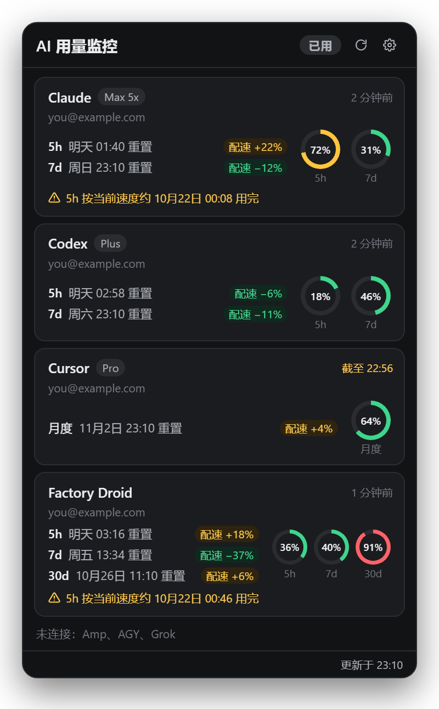

# AI 用量监控

<p align="center">
  
</p>
<p align="center">
  <b>一个常驻系统托盘的小工具，帮你随时盯紧各家 AI 编程工具还剩多少额度。</b>
</p>
<p align="center">
  
  
  <a href="../../releases/latest"></a>
</p>

读取本机已登录的 AI 编程工具的用量和额度，集中显示在一个托盘小窗里。支持 **Claude Code**、**Codex CLI**、**Cursor**、**Amp**、**Factory Droid**、**AGY**、**Grok**。

每个额度窗口（5 小时、7 天、30 天等）用多少、什么时候重置、按现在的速度会不会提前用完，打开面板就能看到。某个工具取数失败或者没登录，不会影响其他工具。

## 界面预览

| 浅色 | 深色 |
|:---:|:---:|
|  |  |

<details>
<summary>设置窗口</summary>
<br />

</details>

> 截图里是示例数据。

## 功能

**看额度**
- 每个额度窗口画成一个圆环：绿色表示宽裕，琥珀色表示用了 70% 以上，红色表示 90% 以上。点击圆环或标题栏的「已用 / 剩余」可以切换显示已用还是剩余。
- 窗口按实际时长命名（`5h` / `7d` / `30d`），直接显示重置时间，比如「明天 09:00 重置」，鼠标悬停能看到还剩多久。
- **配速**：和整个窗口匀速使用相比，现在多用了还是少用了。例如 `配速 +20%` 表示用得比匀速快 20 个百分点。
- **用完预估**：如果按当前速度会在重置前用完，卡片上会提示「按当前速度约 13:50 用完」。
- 卡片上显示套餐和登录账号（如 `Max 5x` · `you@example.com`），以及数据的更新时间。

**更省心**
- **保留上次读数**：遇到限流、断网这类临时故障时，卡片继续显示上次的读数，并标注「截至 HH:MM」，不会一下子变成报错。
- **单卡刷新**：鼠标悬停在卡片上会出现刷新按钮，只刷新这一个工具，不用每次请求所有接口。
- **用量提醒**：任一窗口用到设定比例（默认 90%）时弹出系统通知，每个窗口每个周期只提醒一次。
- **托盘提示**：鼠标悬停在托盘图标上，能看到各工具的用量摘要。
- 面板高度随内容自动调整；没连接的工具折叠成一行显示。

**设置**
- 选择要显示哪些工具，设置刷新间隔，开机自启。
- 界面语言：中文 / English，默认跟随系统；深色模式跟随系统自动切换。
- 网络代理：默认依次读取 `HTTPS_PROXY` / `HTTP_PROXY` 和 Windows 系统代理，也可以手动指定 HTTP 或 SOCKS5 代理。
- 应用内更新：在设置里检查新版本，下载完成后自动安装并重启。

## 下载安装

到 [Releases](../../releases/latest) 页面下载最新的 `*-setup.exe` 安装即可。已安装的版本可以在「设置 → 更新」里直接升级到新版本。

## 使用

- **左键点击托盘图标**，或按快捷键 **`Alt+C`**：打开或关闭面板。面板失去焦点后自动隐藏。
- **右键点击托盘图标**：打开菜单，可以打开面板、进入设置、立即刷新、退出。
- 只需要在本机正常登录各个工具（Claude Code、Codex CLI、Cursor 等），本应用会自动读取它们的登录信息，不需要另外配置。
- 应用只会运行一个实例。重复启动时会直接打开已有的面板，不会多出一个托盘图标。

## 支持的工具及数据来源

| 工具 | 读取的登录信息 | 用量来源 |
|---|---|---|
| Claude Code | `~/.claude/.credentials.json`（OAuth），`~/.claude.json`（账号） | Anthropic usage API：5h、7d 及按模型的 7d 窗口 |
| Codex CLI | `~/.codex/auth.json` | ChatGPT usage API：各窗口按实际时长显示，以及已购买的积分 |
| Cursor | 本地 SQLite `globalStorage/state.vscdb` | Cursor dashboard API：当月用量 |
| Amp | `~/.amp/bin/amp.exe` 或 PATH 中的 `amp` | 解析 `amp usage` 的输出 |
| Factory Droid | `~/.factory/auth.encrypted` 或 `auth.v2.*` | `/api/billing/limits`：5h、7d、30d 滚动窗口，与 `droid /status` 一致 |
| AGY | `~/.gemini/oauth_creds.json` | Google Code Assist quota API（Google AI Plus 套餐不提供用量数据） |
| Grok | `~/.grok/auth.json`（OIDC） | grok.com billing（gRPC-web） |

所有凭据只在本机读取，只发送给对应厂商自己的接口；刷新得到的新令牌只保存在内存里，不会写回各工具的凭据文件。

## 开发

技术栈：Tauri v2（Rust）+ React 19 + TypeScript + Vite

```bash
npm install
npm run tauri dev
```

不想启动界面、只想看看各适配器在这台机器上能不能取到数据，可以运行：

```bash
cd src-tauri
cargo run --example probe                 # 跑一遍所有工具（按设置自动选择代理）
cargo run --example probe -- claude codex # 只跑指定的工具
cargo run --example probe -- --no-proxy   # 不使用代理
```

它会打印每个工具的状态、套餐、账号和各窗口用量，不会输出任何令牌。

推荐 IDE：VS Code + [Tauri](https://marketplace.visualstudio.com/items?itemName=tauri-apps.tauri-vscode) + [rust-analyzer](https://marketplace.visualstudio.com/items?itemName=rust-lang.rust-analyzer)

## 构建

只要一个可执行文件（不生成安装包）：

```powershell
.\build.ps1
```

产物是 `src-tauri\target\release\tauri-app.exe`，双击就能运行。这种方式不生成签名的更新包，不能用于发布自动更新。

> 必须通过 Tauri CLI 构建（`build.ps1` 或 `npx tauri build`）。直接用 `cargo build --release` 编出来的 exe 不会打包前端资源，运行时会去连开发服务器。

## 发布

1. 把 `package.json`、`src-tauri/Cargo.toml`、`src-tauri/tauri.conf.json` 里的版本号改成一致的新版本。
2. 提交改动，推送 `vX.Y.Z` tag。
3. GitHub Actions 会自动构建签名的 NSIS 安装包和更新清单 `latest.json`，并发布到 Releases。

第一次使用前，要先在仓库的 Actions Secrets 里配置 `TAURI_SIGNING_PRIVATE_KEY`；如果私钥设了密码，还要配置 `TAURI_SIGNING_PRIVATE_KEY_PASSWORD`。私钥必须和 `tauri.conf.json` 里的公钥配对，并且不能提交到仓库。

## 已知限制

目前只在 Windows 上开发和测试过。在 macOS 上，Claude Code 把登录信息存在钥匙串里，而不是 `~/.claude/.credentials.json`，所以 macOS 上读不到 Claude 的用量（详见 `CLAUDE.md`）。

## 贡献

欢迎提 Issue 和 PR。新增一个工具只需要两步：

1. 在 `src-tauri/src/adapters/` 下新建一个文件，实现 `pub async fn fetch(ctx: FetchCtx) -> UsageSnapshot`。
2. 在 `adapters/mod.rs` 的 `providers![...]` 列表里加一行。

前端会在运行时从后端获取工具列表，不需要改前端代码。
