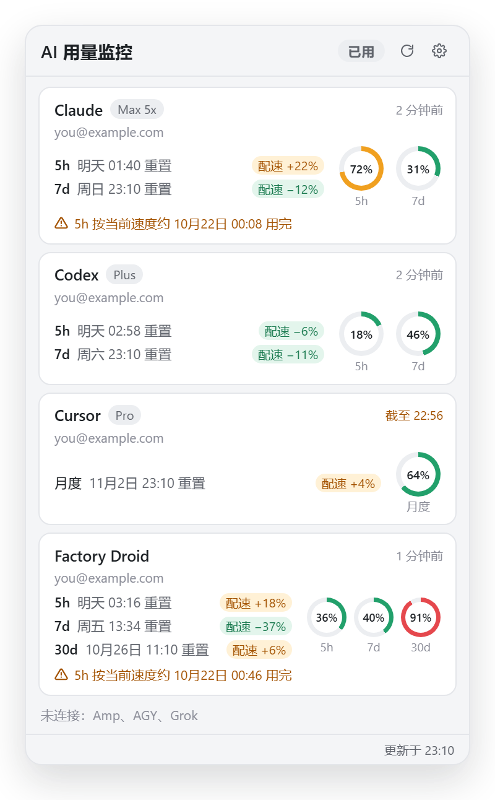
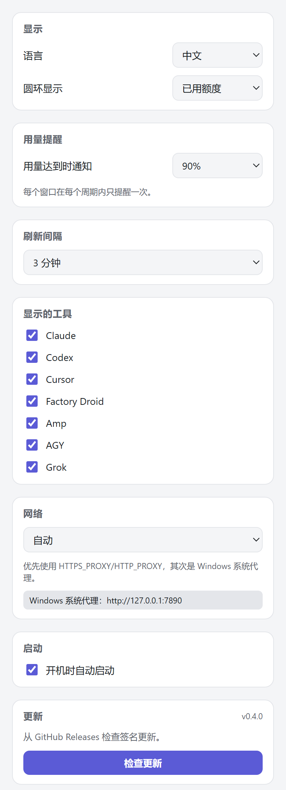

# AI 用量监控

<p align="center">
  
</p>
<p align="center">
  <b>一个常驻系统托盘的小工具，帮你随时盯紧各家 AI 编程工具还剩多少额度。</b>
</p>
<p align="center">
  
  
</p>

Windows 系统托盘小工具，实时展示本机已安装的 AI 编程工具的用量/配额：**Claude Code**、**Codex CLI**、**Cursor**、**Amp**、**Factory Droid**、**AGY**、**Grok**。

托盘图标常驻，点击弹出小窗，各工具的用量、限额、重置倒计时一目了然；某个工具取数失败或未登录，不影响其他工具正常显示。

## 界面预览

| 托盘弹窗 | 设置窗口 |
|---|---|
|  |  |

## 功能

- 托盘弹窗以圆环展示各工具每个额度窗口（5 小时 / 7 天 / 30 天等）的用量，绿 / 琥珀 / 红三色表示剩余情况；点击圆环或标题栏「已用/剩余」切换显示
- 显示套餐与登录账号（如 `Max 5x` · `you@example.com`），以及每张卡片的更新时间
- 绝对重置时间（「明天 09:00 重置」）；**配速**（与匀速使用相比多用/少用了多少）以及按当前速度预估的用完时间
- 遇到限流、断网等临时故障时保留上次读数并标注「截至 HH:MM」
- 每张卡片可单独刷新（悬停显示刷新按钮）
- 用量提醒：任一窗口达到设定比例（默认 90%）时发送系统通知，每个窗口每个周期只提醒一次
- 托盘图标悬停提示显示用量摘要；面板高度随内容自适应；未连接的工具折叠为一行
- 中文 / English 界面（默认跟随系统），自动适配深色模式
- 设置窗口可选择要监控哪些工具、刷新间隔、是否开机自启
- 网络代理：默认自动读取 `HTTPS_PROXY`/`HTTP_PROXY` 与 Windows 系统代理，也可手动指定 HTTP 或 SOCKS5 代理
- 可在设置窗口检查新版本、查看下载进度并自动安装重启
- 后台按设定间隔自动轮询，也可手动立即刷新
- 各工具适配器相互隔离，单个工具取数失败不影响其他工具

## 下载

不想自己编译的话，直接去 [Releases](../../releases) 页面下载最新的 Windows 安装包（推荐 `*-setup.exe`）。从 `v0.2.0` 起，安装版支持在设置窗口内检查和安装后续更新。

## 技术栈

Tauri v2（Rust）+ React 19 + TypeScript + Vite

## 开发

```bash
npm install
npm run tauri dev
```

## 构建

只想拿到一个可执行文件（不生成安装包）：

```bash
npm run tauri build -- --no-bundle
```

产物在 `src-tauri/target/release/tauri-app.exe`，双击即可运行。该方式不会生成签名更新包，不用于发布自动更新。

如果需要生成安装包（`.msi` / NSIS `.exe`，安装后才会正常注册到系统、支持开机自启）：

```powershell
$env:TAURI_SIGNING_PRIVATE_KEY=Get-Content -Raw "$HOME\.tauri\usage-show.key"
$env:TAURI_SIGNING_PRIVATE_KEY_PASSWORD=""
npx tauri build
```

产物在 `src-tauri/target/release/bundle/` 下。更新包必须使用与 `src-tauri/tauri.conf.json` 中公钥配对的私钥签名；私钥只应保存在本机安全位置或 GitHub Actions Secret 中，不能提交到仓库。

维护者发布新版本时，需要让 `package.json`、`src-tauri/Cargo.toml`、`src-tauri/tauri.conf.json` 的版本一致，并推送对应的 `vX.Y.Z` tag。仓库的发布工作流会生成签名安装包和更新清单；首次使用前需在 GitHub Actions 中配置 `TAURI_SIGNING_PRIVATE_KEY`（以及私钥有密码时的 `TAURI_SIGNING_PRIVATE_KEY_PASSWORD`）。

推荐 IDE：VS Code + [Tauri](https://marketplace.visualstudio.com/items?itemName=tauri-apps.tauri-vscode) + [rust-analyzer](https://marketplace.visualstudio.com/items?itemName=rust-lang.rust-analyzer)

## 支持的工具及数据来源

| 工具 | 数据来源 |
|---|---|
| Claude Code | `~/.claude/.credentials.json`（OAuth）+ Anthropic usage API |
| Codex CLI | `~/.codex/auth.json` + ChatGPT usage API |
| Cursor | 本地 SQLite（`globalStorage/state.vscdb`）+ Cursor dashboard usage API |
| Amp | `amp` CLI 输出解析 |
| Factory Droid | `~/.factory/auth.encrypted` 或 `~/.factory/auth.v2.*` + `/api/billing/limits`（5h / 7d / 30d 滚动窗口，与 `droid /status` 一致） |
| AGY | `%LOCALAPPDATA%/agy/bin/agy.exe` + `~/.gemini/oauth_creds.json` + Google Code Assist quota API |
| Grok | `~/.grok/auth.json`（OIDC）+ grok.com billing gRPC-web |

## 已知限制

目前仅在 Windows 上开发和验证；Claude 凭据读取在 macOS 上存在已知的兼容性缺口（macOS 版 Claude Code 把凭据存在钥匙串中，详见 `CLAUDE.md`）。

## 贡献

欢迎提 Issue / PR，尤其是新增工具适配器（在 `src-tauri/src/adapters/` 下新增一个文件，实现同样的 `fetch()` 约定即可）或补充截图。
